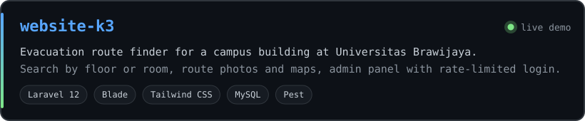

## About me

Hi, I'm Shafiq. I'm a web developer and an IT student at Universitas Brawijaya in Malang, Indonesia. I like building web apps with PHP, Laravel and MySQL, and I'm always looking for the next thing to learn.

## Currently working on and learning

## Tech stack

LANGUAGES &amp; FRAMEWORKS 

FRONTEND 

DATABASE 

TOOLS 

## Featured project

 
<a href="https://vokasievac-k3.infinityfree.io/">Open the live demo</a>

## How to reach me

