IT student at Universitas Brawijaya, based in Malang. Focused on web development, exploring AI and machine learning.

## Tech stack

## Featured project

website-k3 is a web app for finding and managing building evacuation routes (K3 safety) for a campus building at Universitas Brawijaya. Built with Laravel 12, Blade, Tailwind CSS, and MySQL, with an admin panel, multi-image upload, and rate-limited login.

Repo: https://github.com/Mikosfy14/website-k3

Live demo: https://vokasievac-k3.infinityfree.io/
